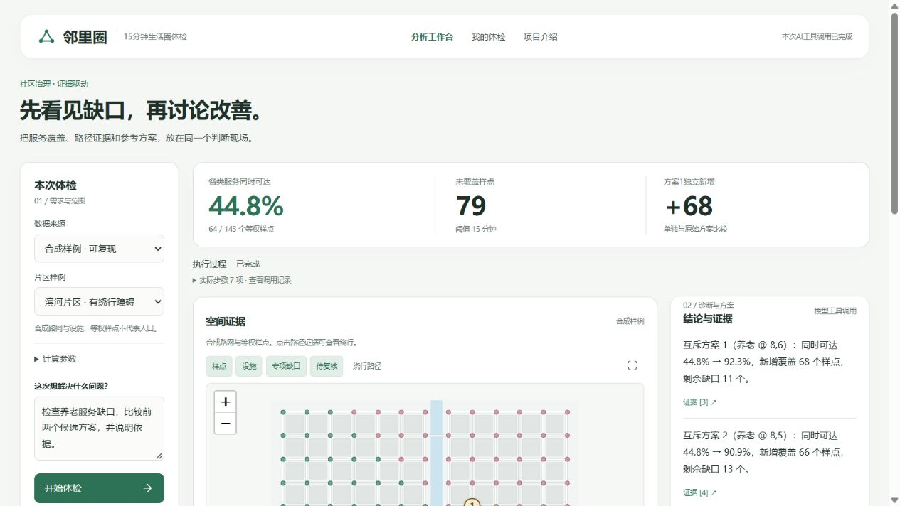

# 邻里圈

**走得到，才算生活圈。** 面向街道与社区调研的15分钟生活圈智能体检与规划助手。

[](https://github.com/wyb123465/neighborhood-circle/actions/workflows/ci.yml) · [MIT](LICENSE) · [AI接入](docs/ai-integration.md) · [验收记录](docs/acceptance-v0.6.md)

自然语言提出问题，模型选择受约束的工具；路网、服务覆盖、候选增益与证据由程序计算。合成、历史回放和当前百度数据分别标明，未知不会冒充确定缺口。



## 本地启动

需要 Python 3.12/3.13；源码中的 Leaflet 与 Lucide 已本地化。

```powershell
python -m venv .venv
.\.venv\Scripts\python.exe -m pip install -r requirements.txt -c constraints.txt
.\.venv\Scripts\python.exe scripts/serve.py --mode synthetic
```

打开 <http://127.0.0.1:8000> 查看项目首页，分析工作台位于 `/assistant.html`，原合成计算明细位于 `/diagnosis.html`，真实数据明细位于 `/live.html`。

Linux/macOS：`bash start.sh`。Docker：`docker compose up --build`。默认 `synthetic` 启动跳过本地 `.env`，不请求地图或模型，适合离线复现。

## AI 与真实地图

在本地创建 `.env`，参照 [.env.example](.env.example) 填写 `AI_BASE_URL`、`AI_API_KEY`、`AI_MODEL`。支持 Chat Completions / Responses 协议，需选择支持工具调用的服务。百度实时数据另需服务端 `BAIDU_MAP_AK`、正确IP白名单及配额。

```powershell
# 模型联网，地图使用合成路网
.\start.ps1 -Mode assistant
# 模型联网，地图使用当前百度数据
.\start.ps1 -Mode assistant -MapMode live
```

Linux/macOS对应 `bash start.sh assistant 8000 synthetic` / `bash start.sh assistant 8000 live`。未配模型时明确显示规则分析；模型服务失败不会伪装成功。详情见 [接入与验收说明](docs/ai-integration.md)。

历史回放需要本机私有录制文件，未随公开仓库分发。`assistant -MapMode replay` 会保留录制时点，不能当作当前地图状态。

## v0.6 能做什么

- 统一项目首页和分析工作台：主要指标、地图、结论与候选并排；完成后的步骤可展开。
- 实际模型工具调用、信息不足追问、同条件证据复用、候选重算、停止和重试。
- 图层控制、设施详情、合成绕行路径，以及真实点位的官方路线核对链接。
- 10/15/20分钟情景对比：固定样点与范围，真实模式复用原始秒数，不新增地图请求；不混用加密点和均匀样点分母。
- 本机体检快照与核验备注：保留来源、日期及原始结果，加载快照后重新体检才能继续AI追问。
- 摘要打印预览、A4打印入口及Markdown报告；原有页面继续支持JSON导出。

真实道路底图尚未嵌入；当前真实图是BD-09坐标转成局部米制的样点示意。已提供官方地图核对入口。浏览器端底图需要单独配置网页端AK。

## 可复现案例与边界

滨河合成片区、仅养老、15分钟、80米/分钟：覆盖44.8%，缺口79/143。首个候选分别重算后覆盖92.3%，独立新增68个样点，剩余缺口11。案例用同一份路网与设施复算，不对应真实上海社区。

等权样点不代表人口或土地面积。真实设施统计是中心到已评估设施的路线证据，不是居民服务覆盖率。候选参考点不证明地块可建、容量充足或建设收益。

三条近阈值路线在百度单条与批量接口之间存在跨阈值分歧，原始判别和待复核状态保留。2分钟敏感窗口是复核策略，不能称作误差置信区间。

## 验证

```powershell
.\.venv\Scripts\python.exe -m pytest -q
node --test tests/*.test.cjs
.\.venv\Scripts\python.exe scripts/verify_release.py
.\.venv\Scripts\python.exe scripts/security_scan.py
```

[GitHub Actions](https://github.com/wyb123465/neighborhood-circle/actions)验证源码、合成真值和无凭证路径。真实模型与百度验收单独记录，不能用Mock测试替代。执行真实联调：`python scripts/check_assistant.py --base-url http://127.0.0.1:8000`。

## 开源与参赛

本仓库为“邻里圈”独立项目。`.env`、私有响应、虚拟环境和本地产物不进入仓库；服务端AK与模型密钥不进入浏览器。上游组件许可见 [THIRD_PARTY_NOTICES.md](THIRD_PARTY_NOTICES.md)。

参赛材料与填写模板见 [报名提交说明](docs/submission-guide.md)。团队署名、公开视频链接和最终报名提交由团队填写与完成；现场出入口、POI营业状态及非开发者试用仍需补充。

版本与历史：[CHANGELOG](CHANGELOG.md) · [v0.5验收](docs/acceptance-v0.5.md) · [历史复现说明](docs/history-readme-v0.5.md)。
