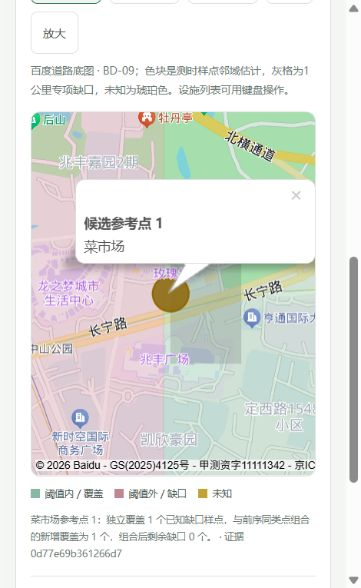

# 2026-10-16 提交前复核

项目：邻里圈，v0.7.0。官网公布的材料清单为代码仓库链接、作品介绍和演示视频链接，截止2026-10-16 24:00（北京时间），最终按报名确认邮件处理。[官网](https://www.oschina.net/os2026/)

## 今日已完成

- 首轮独立源码123项Python测试通过；录制反馈修订后127项全部通过、无跳过，公开资源、HTTP启动、无密钥路径及源码安全扫描通过。测试临时目录独立于解压源码目录，避免测试样本混入发布扫描。
- 前端26项测试通过，含地图定位、迟到保护、方案切换不累加以及旧快照不伪造图层；格式检查与安全扫描随最终发布执行。
- 本次新版录制入口是 http://127.0.0.1:8038/assistant.html 。8016保留旧后端进程，录制本轮功能使用8038。
- 国内出口变化导致百度IP校验失败；修正同一服务端应用的白名单后，1次地理编码、4次POI、3次步行路线共8次真实调用通过。
- 五条真实模型场景再次全部通过：含糊需求追问、合成体检与两个候选、同条件追问复用、改时间重算、当前百度地图与候选比较。实时场景3轮模型、45次地图请求，来源为live-partial；不冒充历史回放。
- 提交资料改为带日期的介绍文档；只使用已公开的GitHub维护账号标识项目维护者，正式参赛人信息以报名表和提交邮件为准。
- 参赛人将重新录制视频；本次提交前资料包不加入旧的截图讲解视频或旧字幕，录制提纲已备。
- 按录制反馈改为真实体检优先；离线养老示例以当前布局/方案一/方案二切换，明确79→11/13个缺口。指定菜市场时不会替换为最弱的养老类别；详见[体验修订](rework-2026-10-16.md)和[成熟项目参考](open-source-references.md)。
- 修订后五条真实模型场景再次全部通过，其中实时场景45次地图请求；另一次浏览器真实流程也完成3轮模型、3次工具、45次请求，候选类别为菜市场。结果来源、未知和现实核验限制保留。

## 网页底图状态

经参赛人确认，已创建独立浏览器端应用“邻里圈-网页地图”，只启用Javascript API与jsapi底图，Referer限定`127.0.0.1,localhost`。新AK仅保存本地`.env`，服务端AK继续单独使用，未写入源码或提交包。

实际浏览器SDK验收通过：愚园路样区再次完成3轮模型、3次工具及45次新地图请求；检索去重69处POI，评估20处设施，56个测时样点，49个专项样点，菜市场已知缺口1点。道路底图、中心、BD-09测时色块、灰格、设施与候选点均实际显示；缩放、范围复位、图层切换、设施详情与示意切换可用。验证期间初次隐藏容器出现过一条SDK framebuffer警告，展开后道路和图层成功绘制，未出现鉴权失败。

实测发现连续定位/缩放时，视图切换和SDK延迟复位可能覆盖候选定位。已将定位安排在地图和视图就绪后，关闭这些程序调用的地图动画；同一真实结果复测通过。保存后重新加载的画面明确标注“本机历史快照”，不冒充新发地图请求。

录制复核补充：设施耗时列表增加明确的步行起点名称、BD-09坐标和“定位起点”入口，地图常驻“起点 · 体检中心”标注并与设施图层分开。设施详情列明起点/终点及坐标；已用本次保存结果核对第一医药2.6分钟与官方链接的同一起终点一致，未额外发起算路请求。输入道路名称只定位道路代表点，不自动认定为社区入口。

## 真实验证限制

已有20条同平台网页路线对照，17条阈值判断一致、3条分歧保留；已有三类设施的政府公开资料交叉核验。独立社区行政归属、实际入口、营业状态与缺口真值尚无新增记录，空白模板不能当作已通过。

这些限制会保留在介绍和报告中；不报告未经验证的现实准确率、人口覆盖或建设收益。

## 录制后由参赛人补齐

1. 新录屏的可访问链接，用未登录窗口验证播放。
2. 真实个人/团队名称、成员、联系人，以及报名确认信息。
3. 按确认邮件提交并保存送达回执。代码发布和资料打包本身不等于向赛事正式递交。

本轮没有自动报名、上传视频或发送邮件。旧版PDF、视频和提交包继续保留为历史记录；本次使用带2026-10-16日期的提交前材料。
