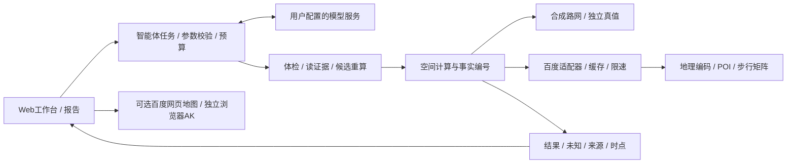

# 技术架构与计算口径

版本0.7.0，2026-10-14。当前助手使用真实模型工具调用；旧关键词接口仅为兼容入口，不代表模型能力。当前验收见 acceptance-v0.7.md。

## 分层与边界

- `assistant_api.py`：任务生命周期、模型轮次与工具预算、取消、追问及结束验证。模型只能引用合法事实编号，不允许同时输出结论和缺信息追问。
- `assistant_tools.py`：工具参数校验、合成/实时数据选择、候选复算、证据组织；数值不是模型生成的。
- `analysis.py`：合成图的Dijkstra可达性、分类覆盖交集、候选独立增益；合成底图从同一图生成。143等权节点不代表真实人口。
- `live_inspection.py`：地理编码、分类检索、UID合并、子类筛除、路线选择和1公里专项。未评估、失败、范围不足分别保留。
- `live_isochrone.py`：原始百度测时、预算内粗网格与边界加密；均匀点与加密点分母分别统计。输出采样事实，不拟合精确连通边界。
- `scenarios.py`：同一范围、同一组均匀样点复用原始秒数，比较10/15/20分钟；不增加地图请求，不把有限范围称为三条完整等时圈。
- `baidu.py`：服务端凭证、超时、缓存、每进程共享在途限制与加权QPS。先获得在途位置再安排发送间隔，避免排队期间预约失效后集中发起。多进程/多服务仍需统一配额管理。
- `display_config.py` / `geo-map.js`：只公开独立浏览器AK；百度JSAPI GL使用原始BD-09点位叠加测时网格、灰格、设施和参考点。未启用或载入失败时保留米制示意。
- `workspace-store.js`：本机最多10条快照与独立核验备注，不保存凭证，不提供云同步；历史加载后重算才能继续AI追问。

## 空间与设施口径

合成步速为用户参数，真实步行耗时直接使用百度返回秒数。官方geoconv将显式GCJ-02/WGS84转换为BD-09，转换失败即停止；合成米制数据不得送入真实接口。

真实设施统计描述中心到已评估设施的路线。设施多于预算时按类别兼顾近处设施，不把其比例写成全量居民覆盖率。1公里专项独立采用直线距离，要求样点的检索证据边界足够完整；失败或截断不能证明设施缺失。

地理地图的色块表示采样点邻域估计，灰格是已知类别缺口，尚有未知类别时用琥珀色；不假设相邻可达点之间全部可通行。距阈值2分钟的复核标记不改写原始判别，不是置信区间。

POI多来源策略见 poi-cleaning.md，真实样区与独立核验待办见 community-validation-2026-10-14.md。既有三条批量/单条阈值分歧保留，不能择优当真值。

## 部署与公开范围

默认synthetic跳过环境密钥并离线运行；assistant配置模型，live另需服务端地图AK与IP白名单。网页道路地图需独立浏览器AK和Referer规则。公开路由为允许清单，绝不静态挂载项目根目录。

公开源码与容器排除.env、私有响应和本地产物。CI执行Ruff/Prettier格式检查、未定义名称、Python/前端测试、合成真值及安全扫描。真实模型、SDK与地图联调单独记录，Mock不证明外部服务可用。
